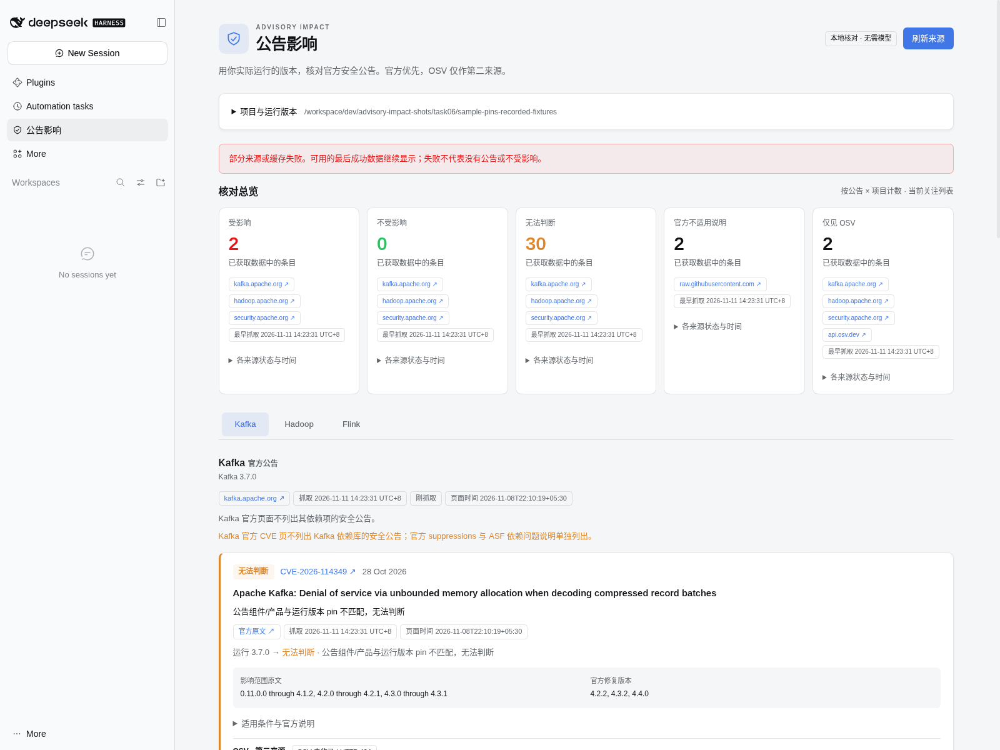
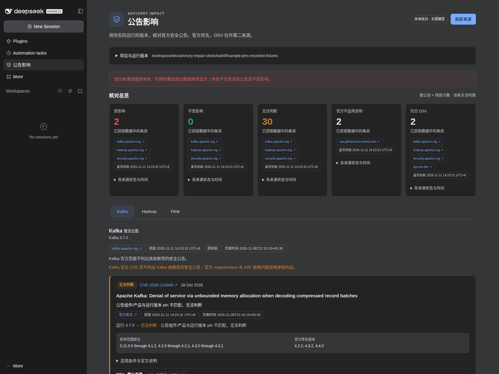
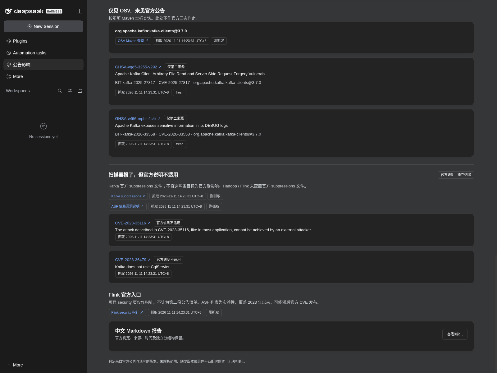

# dsh-advisory-impact

填写你正在运行的 Kafka、Hadoop 或 Flink 版本，在 DSH 里查看哪些官方安全公告受影响、哪些不受影响、哪些仍无法判断。

- **少翻几个官方页面：** 默认关注 Kafka / Hadoop / Flink，在原生「公告影响」面板按项目查看，跟随 DSH 明暗主题，无需模型 API key 或聊天轮次。
- **判断旁边就有依据：** 每条官方结论保留原文链接、抓取时间、影响范围及修复版本；缺版本、范围读不准或组件不匹配时明确显示「无法判断」。
- **分清扫描器提示与官方适用范围：** Kafka 官方不适用说明单列；OSV 只作第二来源，404 和范围分歧均保留，OSV 独有条目单独展示。
- **断网后仍能追溯：** 保留最后成功缓存及原时间，显示刷新失败和陈旧状态；可复制中文 Markdown 报告，或通过命令保存到本地项目。

## 看看界面

入口：DSH 侧栏 → **公告影响**。以下均为真实 DSH Web 原生面板截图，使用 **2026-11-11 录制夹具和演示版本**，不代表你的真实集群或当前官方清单。Kafka 清单在这次回放中取受控子集，以演练 OSV-only 分组；界面抓取时间是回放时间。红色提示来自未录制的 OSV 查询，不是把缺失数据当成安全结论。



<details>
<summary>深色主题与官方不适用说明</summary>





</details>

## 三步开始

1. **完全退出桌面 DSH。** 关闭所有窗口，并从系统托盘退出。准备一个本机已有项目目录，以及你实际运行的产品版本；插件没有默认运行版本。
2. **从 Git 安装。** 当前没有 npm 发布包，使用带引号的 Git 地址：

   ```powershell
   dsh plugin --profile desktop add "github:hzopc1031/dsh-plugins#main&path:/packages/dsh-advisory-impact"
   ```

   需要 Node.js ≥22、DSH `>=0.2.1-rc.5 <0.3.0-0`。Windows 若提示 desktop 环境由 Electron 管理，请使用桌面版自带的 CLI，见[仓库安装说明](../../README.md#安装--installation)。
3. **重开 DSH，点击侧栏「公告影响」。** 展开「项目与运行版本」，输入本地项目绝对路径并点击「读取项目」；填写项目 id 和实际运行版本，点击「保存版本」，再点击「核对 / 刷新」。你会看到总览、项目标签、带官方链接和 UTC+8 时间的三态卡片。没有填写版本的项目仍列出公告，理由为「未填写运行版本，无法判断」。无需添加模型 key；宿主初次出现登录/key 提示时可关闭后使用面板。

## 日常怎么用

**核对版本。** 默认关注 `kafka,hadoop,flink`，可以在面板更改关注列表。每个项目的表单保存一个版本；组件和 Maven 坐标可选。组件公告需要相符的组件 pin，例如 Kafka Clients 或 Flink Kubernetes Operator，不能用核心产品版本替代。保存新版本或关注列表后会清除旧结论，重新核对后再查看。

**分清三类结果。** 项目公告卡片给出「受影响 / 不受影响 / 无法判断」，保留官方限制条件。独立的「扫描器报了，但官方说明不适用」来自 Kafka 官方 suppressions 文件；没有虚构 Hadoop/Flink 文件。「仅见 OSV，未见官方公告」只展示第二来源记录，不产生官方三态结论。OSV 与官方范围不同也不会覆盖官方结论。

**保留一份报告。** 面板底部「查看报告」→「复制报告」；剪贴板不可用时可选中文本全文复制。在已选项目的会话里，也可用以下命令；它们本身不调用模型：

| 命令 | 用途 |
| --- | --- |
| `/advisory-impact help` | 查看产品、来源和全部用法 |
| `/advisory-impact pin` | 查看已填写的版本 |
| `/advisory-impact pin <project> <version> [component=<name>] [maven=<groupId:artifactId>]` | 保存该项目版本；Maven 字段不含版本 |
| `/advisory-impact pin remove <project>` | 移除该项目版本 |
| `/advisory-impact watch kafka,hadoop,flink` | 替换关注列表；`watch none` 清空 |
| `/advisory-impact refresh` | 强制刷新，失败时显示最后成功缓存及错误 |
| `/advisory-impact report` | 输出完整中文 Markdown |
| `/advisory-impact report save` | 保存当前项目的 `advisory-impact-report.md` |
| `/advisory-impact open` | 在命令输出中读取已保存报告 |
| `/advisory-impact lookup <CVE-id>` | 查看单条官方依据、OSV 和不适用说明 |

Web 空白新会话在没有模型配置时可能清除命令输入而不显示结果；此时直接使用侧栏面板。宿主创建的项目会话命令执行已验证，无需模型轮次。

## English

Pin your running Kafka, Hadoop or Flink version and check official security advisories in DSH's native **公告影响** sidebar panel. The three official outcomes are affected, not affected and unknown. Every official verdict includes its source link and fetch time (Asia/Singapore, UTC+8). Missing versions, ambiguous ranges, prereleases and component mismatches stay unknown.

The default watch list is Kafka / Hadoop / Flink. Official pages are authoritative; OSV is a secondary source and can return HTTP 404. Disagreements stay visible. Kafka's official dependency suppressions and OSV-only records have separate sections. Flink's ASF list is experimental, covers advisories since 2023 and may lag CVE publications; Kafka's CVE page excludes dependency advisories.

This is unreleased: use the quoted Git install command above. Reopen DSH, select the panel, enter an existing local project path, save your actual running version, and refresh. No model API key or chat turn is needed. Screenshots show recorded fixture replay with sample pins, including a controlled Kafka inventory subset, rather than live inventories or a real cluster.

## 公司内网访问

大公司常用代理自动配置脚本（PAC），按访问的网站选择出口，不一定有一个固定代理地址。这三个联网插件会读取 Windows 当前用户的 PAC / 静态系统代理，使用解析出的 HTTP(S) 代理；常见公司内网可少一步寻找代理地址和手写 `.env`。已有 `httpsProxy` 或 HTTP(S)/ALL_PROXY 环境变量时完全沿用原策略，不运行 PAC 检测；没有系统代理、PAC 返回 DIRECT 或检测失败时沿用原请求路径。`systemProxy: "off"` 关闭检测。不修改 `.dsh/.env` 或进程环境；仅点击雷达的「应用到插件设置」才保存代理到该插件的 `httpsProxy`，清空恢复自动检测。

请求默认超时 **30 秒（30 000 ms）**，`timeoutSeconds` 可调整，限制 10–120 秒；无效值回到 30 秒。系统设置与 PAC 脚本在进程中缓存 30 分钟，可手动重新检测。仅支持 HTTP(S) PAC 地址，file:// 和 SOCKS 会提示并回到原路径。公司根证书仍可通过 `caBundlePath` / `NODE_EXTRA_CA_CERTS` 配置；不要随意开启 `insecureSkipTlsVerify`。

Windows 注册表读取由模拟注册表的单元测试覆盖，本次只在 Linux 验证，未在真实公司 PAC、Windows Desktop 上实测。PAC 来自公司网络且本身是代码，Node vm 不是抵御蓄意攻击者的安全边界；无宿主对象、禁止动态代码生成、大小/时间限制和输出转字符串用于降低风险。完整配置及边界见[公司内网配置](../../docs/intranet-network.md)和[PAC 范围说明](../../docs/intranet-pac.md)。

运行 `/advisory-impact detect-proxy` 查看系统检测结果，`redetect-proxy` 清缓存重检；`diagnose` 同时显示 PAC 和有效超时。需要固定代理时在插件设置填写 `httpsProxy`，清空恢复自动检测。官方匿名来源只跟随已有来源主机白名单内至多 5 次 HTTPS 跳转，拒绝站外、HTTP、凭据、IP、循环及超限跳转。

Large companies commonly use PAC auto-configuration to select a proxy per website. These plugins read Windows user PAC / static system proxy settings and use the resolved HTTP(S) proxy, reducing the need to find an address and hand-edit `.env`. Explicit plugin or environment proxies bypass detection. No system proxy, PAC DIRECT, or detection failure preserves the original request path; `systemProxy: "off"` disables detection. Nothing writes `.env` or process environment. Requests default to 30 seconds; `timeoutSeconds` clamps to 10–120 seconds (invalid values use 30). Registry/PAC behavior is covered by mocked unit tests and Linux replay only, not a real corporate PAC or Windows Desktop. PAC is network-supplied code; vm is not a security boundary.

运行 `/advisory-impact diagnose` 检查 DNS / TCP / TLS 与代理来源。同原因错误在面板合并显示。`snapshot-export` 将官方缓存导出到项目内 `.advisory-impact-snapshot.json`；拷贝到目标项目同名位置后运行 `snapshot-import` 导入。开启 `offlineOnly` 仅使用本地缓存/快照；缺失的 OSV 第二来源仍标为不可用。

## 补充说明 / Details

### 来源与判断边界

- 官方清单：[Kafka CVE list](https://kafka.apache.org/community/cve-list/)、[Hadoop CVE list](https://hadoop.apache.org/cve_list.html)、[ASF Flink advisories](https://security.apache.org/projects/flink/)。[Flink security](https://flink.apache.org/what-is-flink/security/) 仅作入口指针，不重复计数。ASF Flink 列表为实验性，覆盖 2023 年以来，可能滞后；Kafka 页不列出依赖库安全公告。
- 不适用说明：[Kafka 官方 XML](https://raw.githubusercontent.com/apache/kafka/trunk/gradle/resources/dependencycheck-suppressions.xml)，同时引用 [ASF report-dependency](https://security.apache.org/report-dependency/)。遇到尚不支持的条件型 suppression 会明确失败，不扩大适用范围。
- OSV 按官方 CVE id 公开查询；可选 Maven 坐标会把该坐标和所填版本发送到 OSV 查询接口。HTTP 404 表示 OSV 未收录，不能推断没有漏洞。官方清单不可用时不能完成 OSV-only 对照。
- 只解析明确支持的数字版本及范围措辞。RC、SNAPSHOT、无法完整解析的范围、无法匹配的组件或未明确覆盖的多分支区间保留 unknown；官方配置前提仍需人工核对。「不受影响」仅针对该条公告与所填版本，不是整体安全保证。
- 当前只有 Kafka/Hadoop/Flink 官方适配器；新增其他关注 id 会明确提示无适配器。这不是 lockfile 扫描器、可达性引擎或自动升级建议器，与 `dsh-apache-radar` 是独立插件。

### 本地文件与缓存

项目配置写入固定文件 `.advisory-impact.json`；命令保存报告使用 `advisory-impact-report.md`。拒绝路径穿越和符号链接。模型工具 `advisory_impact_pin/watch/refresh/report/open/lookup` 受调用者目录约束，默认返回摘要和路径，不倾倒 HTML。

来源缓存在插件自有 `~/.cache/dsh-advisory-impact/{official,osv}`，保存 URL、响应、抓取时间及页面时间（如有），默认有效期 6 小时。读取项目/保存配置不联网；「使用缓存核对」遵循有效期，「刷新来源」强制刷新。抓取或解析失败保留最后成功记录及原时间，并显示错误；没有缓存时显示来源不可用，绝不伪装成零条或不受影响。No first-class `ctx.cache` is used.

只请求文档列出的公开来源，不登录、不自动上传项目或报告、不启用 Remote API、无遥测，不自动发布内容或修改生产配置。模型不参与公告清单、范围或判定生成。

### 版本与验证

`0.1.3` 未发布 npm，仅供 Git 分支安装；没有合并 main、PR 或市场提交。声明兼容 DSH `>=0.2.1-rc.5 <0.3.0-0`、Node.js `>=22`；历史在 Linux 加载并验证的是 **DSH 0.2.2-rc.1 / 源码 fcc0ad46**；内网分支另对照官方 tag 源码 `66491b05`。最低开发 peers 的类型构建通过，不据此宣称所有版本或 Electron 桌面实测通过。预编译 `lib/` 已提交，无安装生命周期脚本。

已在真实 DSH Web、零模型 key、无聊天轮次下验证面板导航、版本编辑、项目切换、报告、明暗主题、OSV 404/分歧和故障后的缓存回退。单元与集成测试仅用带来源的录制夹具；最终独立烟测也成功读取六个公开官方端点及一条 OSV GET，报告保留实际来源与时间。截图来自录制回放，不冒充该次实时抓取。

开发校验：在包目录运行 `npm test && npm run verify-pack`。固定决策见 [decisions.md](docs/decisions.md)，DSH 接口依据见 [dsh-api.md](docs/dsh-api.md)。


### 0.1.2 兼容性声明

本版声明 DSH `>=0.2.1-rc.5 <0.3.0-0`。官方版本检查使用 `semver.satisfies` 并开启 `includePrerelease`：接纳 0.2.1-rc.5、0.2.2-rc.1 及后续 0.2.x 预发布/正式版，排除 0.3.0（含预发布）。DSH peer 显式覆盖两个已知 RC，Cordis / Schemastery peer 覆盖两个官方 tag 的版本；开发依赖不变。此次没有安装到用户 DSH；准入通过不等于逐版本功能或界面验证通过。

校验逻辑、源码对照与本次检查结果见[兼容性报告](../../docs/engines-compatibility.md)。

当前兼容声明与 Linux 0.2.2-rc.1 加载结果见[兼容矩阵](../../docs/compat-matrix.md)；范围声明不表示逐版本实测，Windows / Electron 未在本机验证。
