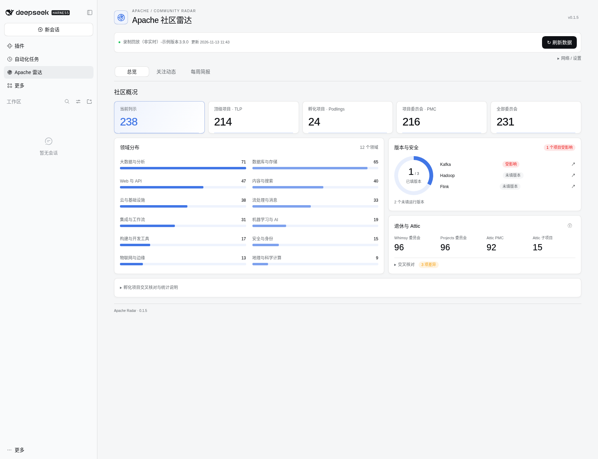
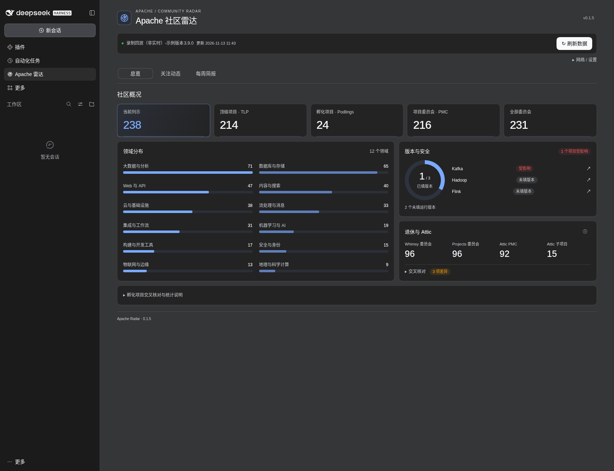
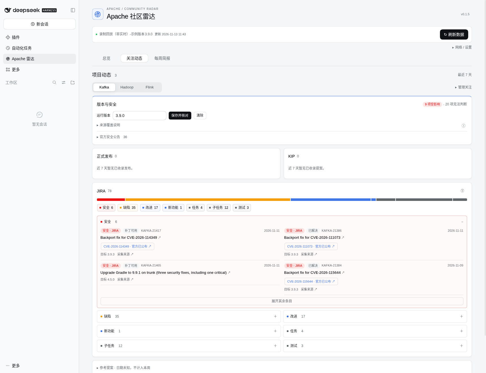

# dsh-apache-radar

把你关注的 Apache 项目动态整理成一份带原文链接的中文周报，同时核对你运行版本的官方安全公告，看清“项目数量”的不同官方口径。

- **不发消息也能查看：** 从 DSH 侧栏打开「Apache 雷达」，总览、关注动态和每周简报随宿主切换明暗主题，无需模型 API key。
- **看清数字为何不同：** 当前列示、顶级项目（TLP）、项目管理委员会（PMC）、全部委员会和孵化项目并列展示；退休委员会与 Attic 的 PMC／子项目保留各自口径和名单差异。
- **少翻多个页面：** 默认关注 Kafka / Hadoop / Flink，按项目查看发布、JIRA 工单和 KIP / FLIP 提案；在项目页的「版本与安全」填写实际运行版本，查看官方公告的受影响／不受影响／无法判断、修复版本与原文；安全 JIRA 中的 CVE 可跳到对应公告。
- **把一周留成简报：** 生成可阅读、复制和打开的本地中文 Markdown，附「本周新公告」；来源失败时显示错误与上次成功缓存，保留出处和时间。

## 界面预览

总览用横条图比较领域规模，用环图查看运行版本填写情况；指标来源可悬浮或键盘聚焦查看，网络工具默认收起。

以下均为 **DSH 0.2.2-rc.1 内的真实面板截图**，使用历史录制数据演示，**不是实时官方数量**。画面中的「录制回放（非实时）」标明演示项目；抓取时间为此次回放读取时间，示例运行版本仅用于回放，不代表你的集群。原始录制时间与 URL 保存在[官方公告来源记录](test/fixtures/advisory/provenance.json)、[OSV 录制说明](test/fixtures/advisory/osv-provenance.json)、[测试夹具来源记录](test/fixtures/provenance.json)及 [JIRA 来源记录](test/fixtures/jira-provenance.json)。实际使用时显示公开来源的真实抓取时间与可用的源文件时间。

从侧栏「Apache 雷达」进入总览：紧凑指标和领域图并列展示，悬浮或聚焦查看来源与时间，退休名单差异可展开查看。



深色模式跟随 DSH。总览中的安全卡只统计关注组件，显示未填版本的数量；点组件可跳到它的安全条目。



「关注动态」按项目切换，安全信息就在各项目顶部；输入版本后展开公告，可逐项核对官方范围和修复版本。下图的 Kafka 版本为明确标注的回放示例，不是默认运行版本。



## 三步快速上手

1. **完全退出桌面 DSH。** 关闭所有窗口，并从系统托盘退出 DSH，确认已完全关闭后再安装或更新。需要 Node.js 22 及以上和 DSH 0.2.2-rc.1 及以上（排除 0.3.0 及其预发布版本）。
2. **从 Git 安装。** `0.1.5` 尚未发布到 npm；包内已有界面和后台编译文件，无需允许安装脚本。

   ```powershell
   dsh plugin --profile desktop add "github:hzopc1031/dsh-plugins#main&path:/packages/dsh-apache-radar"
   ```

   若独立 CLI 提示 desktop 只能由桌面应用管理，改用桌面版自带的 CLI，参数和 Git 地址不变：

   ```powershell
   & "$env:LOCALAPPDATA\Programs\DeepSeek Harness\resources\runtime\cli\bin\dsh.cmd" plugin --profile desktop add "github:hzopc1031/dsh-plugins#main&path:/packages/dsh-apache-radar"
   ```

3. **重开 DSH，从侧栏打开「Apache 雷达」。** 确认“Apache 社区雷达”已启用，选择或输入已有本地项目的绝对目录，点击「打开」，再点击「刷新数据」。总览出现指标和领域图后，可在「关注动态」选择组件、填写实际运行版本并保存判定，再切到「每周简报」生成、复制或打开周报。无需创建聊天或填写账号、令牌、模型配置；首次采集需要访问公开 ASF 网站。原有 `/apache-radar help` 等命令仍可在项目会话使用。

## 日常使用

面板的「总览」对照当前列示、TLP、孵化项目、PMC 和委员会，保留退休口径差异与官方多标签分类。「关注动态」切换项目，在「管理关注」中增删项目，顶部「版本与安全」可填写或清除当前项目的运行版本，展开公告查看三种判定、官方原文、限制条件和抓取时间。没有填写版本时全部为「无法判断」，不会替你选择版本。安全 JIRA 标题包含 CVE 时，仅核对已抓取的官方列表，显示「官方已公布」或「官方尚未公布」；列表不可用时明确说明无法核对，旧缓存也会标明。「每周简报」先显示项目阅读卡片，将详细统计和来源明细折叠，并单列「本周新公告」及针对所填版本的判定；「复制 Markdown」和「打开已保存文件」始终使用已保存的完整周报。打开文件会在浏览器新标签显示保存内容；本地原文件位于所选项目目录。

打开面板只读本地缓存，不自动请求 ASF；「刷新数据」一起更新社区动态、官方公告、官方 suppressions 及已查询的 OSV 记录。保存运行版本只在本地重算，不发送版本到第三方。OSV 在展开具体公告时按需查询，只发送公告 id；未收录会明确显示 HTTP 404，范围表述有差异时保留两方依据，官方判定不变。生成周报和原有命令沿用一小时缓存。过期和刷新失败会显示提示，错误不会记为零更新。项目目录选择只在当前浏览器保存；面板、命令和工具共用该目录下的关注列表、缓存和周报。命令仍按所在会话的当前目录工作。

已有命令保持可用：

| 你要做什么 | 命令 |
| --- | --- |
| 查看官方数量、退休差异和多标签分类 | `/apache-radar counts` |
| 查看关注列表 | `/apache-radar watch` |
| 添加或移除项目 | `/apache-radar watch add spark`、`/apache-radar watch remove spark` |
| 按缓存有效期采集，不写周报 | `/apache-radar refresh` |
| 生成／读取最新中文周报 | `/apache-radar brief`、`/apache-radar open` |
| 查看已缓存官方公告及运行版本判定 | `/apache-radar security kafka` |
| 按版本、工单号、提案号或关键词查已采集条目 | `/apache-radar lookup KIP-1356` |

插件设置的 `watchList` 默认为 `["kafka", "hadoop", "flink"]`。命令编辑后，当前项目的覆盖列表优先于插件设置；其他项目各自保存。可添加其他官方项目 id，它们能匹配发布目录；JIRA 适配目前限于 Kafka、Hadoop（含 HDFS / MAPREDUCE / YARN）和 Flink，提案适配限于 Kafka KIP、Flink FLIP。Hadoop 没有已验证的通用 HIP 索引。

聊天工具为 `apache_radar_security`、`apache_radar_counts`、`apache_radar_watch`、`apache_radar_refresh`、`apache_radar_brief`、`apache_radar_open`、`apache_radar_lookup`。默认只返回摘要、状态、路径和链接，`open` 工具只有显式设置 `includeMarkdown: true` 才返回全文。`lookup` 不请求网络，最多返回二十项，并提示是否还有匹配项。`security` 同样只读缓存，可用 `project` 和 `query` 筛选，最多返回二十条公告摘要并保留原文、抓取时间及范围；完整条目在项目页展开。自然语言聊天若由宿主模型调度工具，仍受宿主自身的模型配置约束；斜杠命令和周报生成本身不调用模型。

## English

Check official advisory ranges against locally pinned running versions inside each project page. Keep a linked Chinese weekly brief for watched projects and compare official count scopes without treating them as one universal total. Kafka, Hadoop and Flink are watched by default. Releases, JIRA issues and KIP/FLIP proposals retain their original links and source statuses.

This is **unreleased**. Fully quit DSH Desktop, install using the quoted Git command above, reopen DSH and select **Apache 雷达** in the sidebar. Choose an existing local project directory, refresh, and generate or copy the brief. Slash commands remain available in project sessions. No model key or model call is required by the plugin. English metadata is shipped; panel copy, command output and briefs are Chinese.

Every displayed count includes its source URL and fetch time in Asia/Singapore (UTC+8), plus a source timestamp when available. Retired committees and Attic PMC/subproject scopes stay side by side, including mismatches. GitHub Releases is not the release authority. reporter.apache.org is never used. Nothing is uploaded or automatically published.

The one-hour cache preserves the last good response on failure. JIRA is a capped first page per watched project, not a complete shipped-feature list; fixVersion and accepted proposals do not prove release. Hadoop has no verified general HIP feed. The native panel supports light/dark themes and needs no chat session or model key. No pin means unknown. Official pages are authoritative; OSV lookups are secondary and may return HTTP 404. Kafka suppressions stay separate. Flink’s ASF advisory page is experimental, covers advisories since 2023 and may lag. There is no production-upgrade verdict, foundation-wide daily sweep or automatic schedule.

## 公司内网访问

大公司常用代理自动配置脚本（PAC），按访问的网站选择出口，不一定有一个固定代理地址。这三个联网插件会读取 Windows 当前用户的 PAC / 静态系统代理，使用解析出的 HTTP(S) 代理；常见公司内网可少一步寻找代理地址和手写 `.env`。已有 `httpsProxy` 或 HTTP(S)/ALL_PROXY 环境变量时完全沿用原策略，不运行 PAC 检测；没有系统代理、PAC 返回 DIRECT 或检测失败时沿用原请求路径。`systemProxy: "off"` 关闭检测。不修改 `.dsh/.env` 或进程环境；仅点击雷达的「应用到插件设置」才保存代理到该插件的 `httpsProxy`，清空恢复自动检测。

请求默认超时 **30 秒（30 000 ms）**，`timeoutSeconds` 可调整，限制 10–120 秒；无效值回到 30 秒。系统设置与 PAC 脚本在进程中缓存 30 分钟，可手动重新检测。仅支持 HTTP(S) PAC 地址，file:// 和 SOCKS 会提示并回到原路径。证书不受信任时可通过 `caBundlePath` / `NODE_EXTRA_CA_CERTS` 补充公司根证书。

出现 `CA certificate key too weak`、`CA_KEY_TOO_SMALL` 或 OpenSSL 校验错误 67，表示证书密钥强度不足，与「证书不受信任」不同；OpenSSL 3 的默认安全级别通常要求 RSA 密钥至少 2048 位，报错本身不代表已测得实际位数。`caBundlePath` / `NODE_EXTRA_CA_CERTS` 只能补充信任，不能修复弱密钥。可在插件管理中打开目标插件条目的「配置」，开启「不安全：仅跳过 OSV / GitHub API 证书校验」（`insecureSkipTlsVerifyHosts`，默认 `false`），仅对精确主机 `api.osv.dev` / `api.github.com` 跳过校验；Apache、npm、其他主机、PAC 获取和 HTTPS 代理自身仍校验。跳过会失去目标证书身份保护，请仅在接受风险时开启；优先让网络管理员更新拦截证书。原有 `insecureSkipTlsVerify` 默认也为 `false`，开启会跳过该网络客户端所有目标和 HTTPS 代理的证书校验，范围更大。

Windows 注册表读取由模拟注册表的单元测试覆盖，本次只在 Linux 验证，未在真实公司 PAC、Windows Desktop 上实测。PAC 来自公司网络且本身是代码，Node vm 不是抵御蓄意攻击者的安全边界；无宿主对象、禁止动态代码生成、大小/时间限制和输出转字符串用于降低风险。完整配置及边界见[公司内网配置](../../docs/intranet-network.md)和[PAC 范围说明](../../docs/intranet-pac.md)。

展开「网络 / 设置」，点击「从系统检测代理」查看来源、脱敏 PAC 地址、Apache 示例代理、检测时间、30 分钟缓存和有效超时；「重新检测」清缓存。自动使用系统代理后，提示也保留在设置内。官方匿名来源允许至多 5 次 HTTPS 白名单内跳转，拒绝站外、HTTP、凭据、IP、循环及超限跳转。KIP / FLIP 已改用新的 cwiki spaces 页面。

Large companies commonly use PAC auto-configuration to select a proxy per website. These plugins read Windows user PAC / static system proxy settings and use the resolved HTTP(S) proxy, reducing the need to find an address and hand-edit `.env`. Explicit plugin or environment proxies bypass detection. No system proxy, PAC DIRECT, or detection failure preserves the original request path; `systemProxy: "off"` disables detection. Nothing writes `.env` or process environment. Requests default to 30 seconds; `timeoutSeconds` clamps to 10–120 seconds (invalid values use 30). Registry/PAC behavior is covered by mocked unit tests and Linux replay only, not a real corporate PAC or Windows Desktop. PAC is network-supplied code; vm is not a security boundary.

在「网络 / 设置」中点击「网络诊断」，展开「诊断详情」，查看 DNS / TCP / TLS 及代理来源；主页面只显示简短错误提示，失败来源数量和完整原因保留在诊断详情。「导出快照」「导入快照」可在断网机器复用官方响应，数据标为「本地快照」，保留原抓取时间。`offlineOnly: true` 使刷新也仅使用本地缓存。

Weak certificate keys (`CA certificate key too weak`, `CA_KEY_TOO_SMALL`, verify error 67) differ from untrusted certificates: `caBundlePath` / `NODE_EXTRA_CA_CERTS` cannot repair key strength. The opt-in `insecureSkipTlsVerifyHosts` switch defaults to `false` and skips verification only for exact `api.osv.dev` / `api.github.com` origins, including through CONNECT. Other hosts, PAC retrieval and the HTTPS proxy’s own TLS still verify. The existing global `insecureSkipTlsVerify` also defaults to `false` and bypasses verification for all client targets and HTTPS proxies. Both bypasses remove certificate identity protection; prefer replacing the weak interception certificate.

## 补充说明

### 版本与验证范围

版本 `0.1.5`（未发布），Node.js `>=22`，需要 DSH 0.2.2-rc.1 及以上（`>=0.2.2-rc.1 <0.3.0-0`，排除 0.3.0 及其预发布版本）。周报使用 rc.1 新增的 `MarkdownText.omitHtml` 禁用原始 HTML，因此保留 rc.1 下界。前次接口对照只读源码 `fcc0ad462172522aaf5c93a7b2e01f6b9f0b0159`，内网分支另对照官方 tag 源码 `66491b05e3f05ad35bcdd4f6cd7ed26041d9e3db`；历史实际加载验证版本为 **DSH 0.2.2-rc.1**。本次在 Linux 重新加载真实 rc.1 Web，并回放 PAC 检测及 302 来源；不代表 Windows / Electron 桌面安装均已验证。

Linux 烟测在隔离 profile 中加载真实 DSH Web，使用录制数据验证侧栏入口、无模型且无会话时的直接使用、明暗主题、项目切换、关注编辑、版本保存、公告判定、JIRA 跳转、OSV 404、周报复制、窄屏和失败回退。未验证 Electron 桌面安装；前次任务的公开计数与匿名 JIRA 请求记录仍作为历史证据。本次界面验证不请求实时 ASF 来源。测试夹具保留原 URL、抓取时间、完整性摘要和裁剪说明，历史快照不表示当前官方数量。

### 来源、时间与边界

- 数量读取 [chooser.json](https://projects.apache.org/json/foundation/chooser.json)、[committee-info.json](https://whimsy.apache.org/public/committee-info.json)、[podlings.json](https://projects.apache.org/json/foundation/podlings.json)、[public_podlings.json](https://whimsy.apache.org/public/public_podlings.json)。当前列示解释为 chooser 中当前 TLP 加当前孵化项目，不与 PMC／全部委员会混用；分类沿用 chooser 官方领域标签，一个项目可有多个标签，不能把分类数量相加当总数。
- 退休口径读取 [Whimsy 退休委员会](https://whimsy.apache.org/public/committee-retired.json)、[projects.apache.org 退休委员会](https://projects.apache.org/json/foundation/committees-retired.json)及 [Attic 项目表](https://attic.apache.org/projects.html)。名单不同会明确列出，不猜测如何统一。当前未接入 Attic 年度统计、Release Catalog、DOAP、LDAP、Incubator XML／Clutch 或首页营销数字。
- 发布以 [官方发布目录](https://projects.apache.org/json/foundation/releases.json)为依据，Kafka 还匹配官方下载安装页中的版本说明链接；Hadoop／Flink 没有自动提取版本说明全文。GitHub Releases 不作为权威来源，不使用 reporter.apache.org，不登录或绕过限流。
- 默认窗口为 **Asia/Singapore（UTC+8）滚动最近 7 天**，不是自然周。目录仅有日期时按该时区零点筛选。JIRA 使用最后更新时间，本地再筛选时间边界；每项目只取首个最多 100 条的响应页，有更多结果就提示采集不完整。
- 提案保留讨论、接受、实现、发布等来源状态和限制用语；日期未知的条目单列为参考，不能称为本周新增。JIRA `New Feature`、`fixVersion` 和已接受提案均不证明已经发布；安全公告单独标注。输出不作兼容性或“可安全上生产”的判断。
- 官方公告目前支持 [Kafka](https://kafka.apache.org/community/cve-list/)、[Hadoop](https://hadoop.apache.org/cve_list.html) 和 [ASF Flink](https://security.apache.org/projects/flink/)；新增项目 id 若未适配，显示「尚未支持官方来源」，不会猜测清单。Kafka 页不收录其依赖库公告。Flink [项目安全页](https://flink.apache.org/what-is-flink/security/)只作指向来源，ASF 公告页是实验性列表，覆盖 2023 年以来的公告且可能滞后。
- 判定严格按官方受影响范围和修复文字匹配点分数字版本；预发布版本、不能完整解析的范围、分支不明确或组件不匹配时为「无法判断」并解释原因。当前每个项目只保存一个产品版本；例如 Flink 产品版本不能代替 Kubernetes Operator 版本。判定不表示漏洞可达、不表示可以安全升级或上生产，不扫描锁文件，不使用 NVD 或需要密钥的接口。
- Kafka 的 [官方 suppressions](https://raw.githubusercontent.com/apache/kafka/trunk/gradle/resources/dependencycheck-suppressions.xml)在安全条目底部默认折叠，标题为「官方不适用说明 · suppressions」，保留原注释、时间及 [ASF 依赖问题指导](https://security.apache.org/report-dependency/)。这些条目不计为官方受影响公告。[OSV](https://api.osv.dev/)只按官方 CVE id 做第二来源查询，不创建 OSV 独有公告库存，不覆盖官方判定。
- 「本周新公告」仅列关注项目窗口内的官方公告，优先使用官方公告日期，否则标为「本地首次发现（非发布日期）」；首次建库时，缺少公告日期的历史条目也可能列入。发现时间持久保存，后续刷新不会每周重复计为新增。suppressions 和 OSV 记录不计为新官方公告。
- 本插件通过宿主命令注册表直接执行，不发起模型请求。DSH 0.2.2-rc.1 的空白新会话界面在未配置模型时可能无法提交命令；命令可在已有项目会话使用；现在也可直接从侧栏面板操作，不受聊天提交入口影响。界面烟测没有创建会话、配置密钥或发起模型调用。
- 无自动周报定时器、全基金会每日功能扫描、自动上传、发帖或发布。原始社区雷达边界见[绑定 MVP 决策](docs/decisions.md)；安全公告并入项目页是 2026-11-11 用户后续决定，仍不提供生产安全或升级建议。

### 本地文件与缓存

面板选定目录或会话当前项目目录保存 `.apache-radar-feed-cache.json`（URL、抓取时间、响应及来源时间）、`.apache-radar-state.json`（关注覆盖值、运行版本、采集时间及公告首次发现时间）和 `.apache-radar-brief.md`（最新周报）。文件不自动加入 Git；可自行加入项目忽略规则。只保留最新周报，重复生成会替换它；需要留档时先复制。

缓存有效期一小时；命令 `refresh` 和 `brief` 在有效期内复用，过期才抓取；面板的「刷新数据」主动跳过有效期重新抓取。失败保留上次成功数据和时间，并显示错误；没有成功缓存时显示失败，不写成“本周零更新”。公告解析、版本匹配、suppressions 和 OSV 解析移植自同仓库作者的 MIT 项目 dsh-advisory-impact，在这里共用 Radar 的缓存与刷新，不需要安装另一个插件。公开请求串行执行，带插件 User-Agent、超时和 429 退避。路径必须是本地绝对目录，拒绝 `..` 逃逸和符号链接。

### 开发验证

在包目录运行 `npm ci --ignore-scripts`，然后 `npm test && npm run verify-pack`。测试只使用记录夹具和注入故障，阻断实时 HTTP 与 socket；周报无需模型。`lib/` 已提交，打包检查排除夹具、测试及 `node_modules`，无安装生命周期脚本。


### 0.1.2 兼容性声明

本版声明 DSH `>=0.2.2-rc.1 <0.3.0-0`。官方版本检查使用 `semver.satisfies` 并开启 `includePrerelease`：接纳 0.2.2-rc.1 及后续 0.2.x 预发布/正式版，拒绝 0.2.1-rc.5，排除 0.3.0（含预发布）。原范围 `>=0.2.2-rc.1 <0.3.0` 已能通过 rc.1，此次仅收紧上界。所有 DSH peer 同步为 `>=0.2.2-rc.1 <0.3.0-0`；Cordis / Schemastery peer 和开发依赖保持当前设置。此次没有安装到用户 DSH；准入通过不等于逐版本功能或界面验证通过。

周报保留原有带 `omitHtml` 的 Markdown 渲染，依赖 rc.1 及以上提供该安全属性。

校验逻辑、源码对照与本次检查结果见[兼容性报告](../../docs/engines-compatibility.md)。

当前兼容声明与 Linux 0.2.2-rc.1 加载结果见[兼容矩阵](../../docs/compat-matrix.md)；范围声明不表示逐版本实测，Windows / Electron 未在本机验证。

界面布局与交互参考 dsh-context 0.83.1 的紧凑指标、环图与图例、分组设置及悬浮提示；具体文件与许可见 [THIRD_PARTY_NOTICES](THIRD_PARTY_NOTICES)。实现未复制其源码或 CSS。
